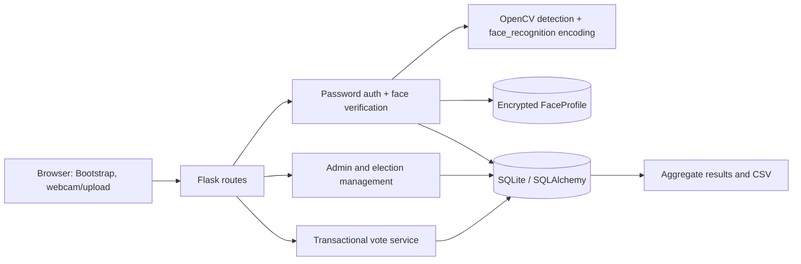

# AI-Based Voting System — Academic Prototype

> **Prototype notice:** This project is for local learning and classroom demonstration only. It is not approved, certified, audited, or suitable for real public elections. It does not provide end-to-end verifiability, trustworthy identity proof, coercion resistance, guaranteed ballot secrecy, or independently verifiable election integrity.

## What this project demonstrates

A beginner-friendly Flask application with voter registration, password plus facial matching, administrator-managed elections and candidates, a confirmation step, database-enforced one-vote-per-voter-per-election, and aggregate results. The database intentionally demonstrates a simple linked-vote design; an administrator or database operator can associate a vote with a voter.

### Features

- Flask application factory, SQLAlchemy models, SQLite development database, and CLI initialization.
- Unique voter IDs/emails, Werkzeug password hashes, role checks, CSRF protection, session cookie controls, login throttling, and security headers.
- Browser webcam capture and JPEG/PNG upload fallback; OpenCV face detection and `face_recognition` encodings.
- Fernet-encrypted facial encodings stored in a separate `FaceProfile` table; submitted images are processed in memory and not retained.
- Elections, candidate administration, status changes, aggregate results, CSV export, and admin audit events.
- Optional candidate images are validated as JPEG/PNG, decoded, re-encoded as JPEG to discard metadata, size/dimension limited, and stored under random filenames.
- A database unique constraint on `(election_id, voter_id)` plus a transaction for vote submission.
- Pytest tests that mock face recognition and need no physical camera.

## Technology

Python 3.10 or 3.11 is recommended for the optional `dlib`/`face-recognition` stack. The project uses Flask, Flask-SQLAlchemy, Flask-Login, Flask-WTF, SQLite, OpenCV, NumPy, `face_recognition`, and Bootstrap 5.

## Architecture



### Voting workflow

```mermaid
sequenceDiagram
  participant Voter
  participant Browser
  participant Flask
  participant DB
  Voter->>Browser: Enter voter ID/email and password
  Browser->>Flask: POST /login (CSRF protected)
  Flask->>DB: Verify password hash; record failed attempts
  Flask-->>Browser: Request separate face verification
  Voter->>Browser: Capture webcam frame or choose JPEG/PNG
  Browser->>Flask: POST /verify-face
  Flask->>DB: Compare against encrypted registered encoding
  Flask-->>Browser: Authenticated voter dashboard
  Voter->>Browser: Select candidate, review, confirm
  Browser->>Flask: POST /elections/{id}/vote
  Flask->>DB: Check election/candidate and insert vote transactionally
  DB-->>Flask: Unique election/voter constraint
  Flask-->>Browser: Vote recorded; never reveal selected candidate
```

## Project structure

```text
app.py                  Flask app factory, headers, CLI commands
config.py               Environment-based settings
extensions.py           SQLAlchemy, Flask-Login, CSRF extensions
models.py               Users, encrypted profiles, elections, candidates, votes, logs
face_service.py         Image validation, face detection/encoding, comparison
auth.py                 Registration, password login, face verification, logout
voter.py                Voter dashboard and election status
voting.py               Confirmation and vote submission routes
admin.py                Admin authentication, management, audit, CSV export
results.py              Published/admin aggregate results
services/               Election parsing and transactional voting logic
templates/              Jinja pages and error templates
static/                 CSS and browser camera helper
tests/                  Pytest suite; face recognition is mocked
instance/                Local SQLite database (created at runtime)
```

## Windows installation and run

Open PowerShell in this project folder. Use Python 3.10 or 3.11 for best compatibility with `dlib`.

```powershell
python --version
python -m venv venv
venv\Scripts\Activate.ps1
python -m pip install --upgrade pip
python -m pip install -r requirements.txt
Copy-Item .env.example .env
```

Edit `.env`: set a unique random `SECRET_KEY`, a valid generated `FACE_DATA_KEY`, and `FLASK_DEBUG=1` for local development. Generate key material with:

```powershell
python -c "import secrets; print(secrets.token_urlsafe(48))"
```

Use the application CLI to generate the Fernet key. Temporarily ensure `.env` has `SECRET_KEY`, then:

```powershell
$env:FLASK_APP = "app.py"
flask generate-face-key
```

Copy that output into the `FACE_DATA_KEY` setting in `.env`. Keep `.env` private; never commit it. The example value in `.env.example` is instructional text and is not a usable key.

The core install includes Pillow for image-dimension checks and does not compile `dlib`, so the rest of the app and mocked tests can run even if facial matching is not yet installed. To enable the real facial matching workflow, install the optional dependency after preparing a compatible CMake and Visual C++ build environment:

```powershell
python -m pip install -r requirements-face.txt
```

`dlib` is difficult to build on some Windows setups. If its install fails, continue with the core dependencies for the non-camera parts and tests; face matching will show a clear unavailable-dependency error rather than authenticating without it.

Initialize the local database and start the app:

```powershell
flask init-db
flask create-admin
python app.py
```

Open <http://127.0.0.1:5000/>. The admin bootstrap prompts for an email, name, and a password of at least 14 characters. It runs only when Flask debug mode is enabled. Set `FLASK_DEBUG=0` when not actively developing. The Flask development server is for local testing only, not public production deployment.

### Render demo deployment

The root `render.yaml` defines a free Render web service and a free Render Postgres database. To deploy, connect the public GitHub repository to Render and create a Blueprint from `render.yaml`. During setup, enter values for `BOOTSTRAP_ADMIN_EMAIL`, `BOOTSTRAP_ADMIN_NAME`, and a unique `BOOTSTRAP_ADMIN_PASSWORD` of at least 14 characters. The password is only read to create the initial admin when no admin account exists; remove all three bootstrap variables from the Render service after the first successful deploy. The manifest generates `SECRET_KEY` and `FACE_DATA_KEY`; the face key is a high-entropy Render-generated secret from which the app derives a Fernet key. Changing the face key later makes already stored face encodings unreadable. Keep these values private.

The first boot initializes tables and creates the first administrator. The app uses the attached Postgres connection, and the health check is `/`. Run only synthetic-data demonstrations. Render's free web services sleep while idle and have ephemeral local filesystems, so uploaded candidate images may disappear after a restart. Free Render Postgres databases expire after 30 days and are deleted after the additional grace period if not upgraded; they have no backups. This is not durable hosting and any data may be deleted. Do not enter real voter identities, facial data, or ballots. A real election requires a separately reviewed, non-free, production-grade system and expert security/privacy approval.

The Render build installs `requirements.txt`; the optional `requirements-face.txt` is not installed by default because compiling `dlib` can fail or exceed free build resources. Until a compatible face-recognition library is deliberately installed, voter registration and face verification will clearly report that the dependency is unavailable. Do not bypass facial verification. The page can be publicly viewed, but do not use it to collect real personal or biometric data.

### Webcam and face recognition setup

The browser asks permission to use a webcam on localhost. If camera access is blocked, select a JPEG/PNG image (up to 4 MB) instead. Images are sent for in-memory processing and are not written to disk. The app requires one visible face and applies a configurable Euclidean distance threshold (`FACE_DISTANCE_THRESHOLD`, default `0.48`); a lower value is stricter but can increase false rejection.

`face-recognition` depends on `dlib`, which can be difficult to build on Windows. Use a supported Python version and install the required C++ build tools if pip cannot find a compatible wheel. Do not silently skip facial verification or lower the threshold to make tests pass. The automated test suite mocks face encoding and does not need `dlib` or a physical camera, but application startup imports OpenCV, NumPy, and Pillow.

## Database design and privacy

- `User` stores identity/profile fields and a Werkzeug password hash. Administrators have `role=admin`, no voter ID, and no facial profile.
- `FaceProfile` has a one-to-one relationship with a user. Encodings are encrypted with an environment-supplied Fernet key; losing that key makes existing profiles unverifiable. Remove a profile by deleting the corresponding account or its local development database. The application does not implement a long-term retention policy or consent withdrawal UI; this must be addressed before any broader use.
- `Election` controls voting windows (entered and stored as naive UTC), status, and result publication.
- `Candidate` belongs to one election. Candidate data/images can only be changed before voting starts and before any votes exist, to avoid changing displayed candidate details after ballots are recorded.
- `Vote` references both voter and candidate. `(election_id, voter_id)` is unique, so replays or concurrent submissions cannot create a second vote for the same voter in that election.

Because `Vote` directly links the voter to the selected candidate, this sample **does not provide ballot secrecy**. A privacy-conscious design would store eligibility/participation separately from anonymous ballot records, with independently protected keys, audited procedures, and a design that prevents re-linking. Such a redesign requires a careful threat model and independent review; merely splitting tables is not a guarantee.

Facial matching has no liveness detection. It may be vulnerable to photographs or replay, affected by lighting and image quality, and exhibit different error rates across demographic groups. A match is not proof of identity. The project does not claim a fixed accuracy. To evaluate false acceptance and false rejection, use a representative, consented, appropriately governed dataset; separate enrollment and evaluation subjects; predefine the operating threshold; report false-acceptance and false-rejection rates with confidence intervals and subgroup analysis; and document all test conditions. Never use real voter biometrics without a lawful basis, informed consent, appropriate retention, and expert review.

The administrator can see aggregate results and participation, but not password hashes or face encodings. Administrative actions are logged. Database totals alone do not prove integrity: the local SQLite database, application host, and privileged administrator remain trusted, and no independent audit or cryptographic end-to-end verification is implemented.

## Security behavior and limitations

- Flask-WTF CSRF protection applies to modifying forms and POST-only actions.
- Passwords use Werkzeug's password hashing; no plaintext password is stored.
- Voter authentication requires password and separate face verification. Similarity alone never logs in a user.
- Login attempts are recorded and throttled per normalized identifier and client IP.
- Route-level role checks protect admin pages and prevent admin accounts from voting.
- Vote submission validates current election status, candidate election membership/activity, and authenticated voter server-side.
- Database uniqueness plus transaction handling prevents duplicate vote submissions.
- Results are shown publicly only after an election is closed or when publication is explicitly enabled; admins can always view aggregate results.
- `SECRET_KEY` and `FACE_DATA_KEY` must come from local environment configuration. Use HTTPS and secure cookies in any controlled deployment; this project is not production-ready.
- There is no certified identity proof, independent election audit, robust liveness detection, hardware security, coercion resistance, ballot secrecy, or protection against a malicious host/admin.

## Tests

Activate the virtual environment and run:

```powershell
python -m pytest -q
```

Tests use a separate in-memory SQLite database and mocked facial recognition. They cover registration, hashed passwords, login and face-verification paths, failed-attempt throttling, role authorization, closed elections, invalid candidates, duplicate submission, logout, aggregate counts, and zero-eligible turnout. The suite cannot certify election security or facial-recognition performance.

## Troubleshooting

- **PowerShell activation is blocked:** For the current user, `Set-ExecutionPolicy -Scope CurrentUser RemoteSigned`, then reopen PowerShell and activate the venv.
- **Missing `SECRET_KEY`:** Confirm `.env` is in the project root and contains a non-empty random key.
- **Fernet key error:** Run `flask generate-face-key`, then copy its output exactly into `FACE_DATA_KEY`. Do not replace the key after enrolling users unless you are intentionally discarding/re-enrolling those profiles.
- **Database missing:** Run `flask init-db` with the same environment variables and project working directory used to run the app.
- **`dlib` / face-recognition installation errors:** Use Python 3.10/3.11 and a compatible compiler/toolchain or wheel. Camera-based flows cannot be verified until the dependency is available; tests are mocked.
- **Camera permission denied:** Allow camera access for localhost in browser settings or use the image upload option.
- **No face/multiple faces:** Ensure one face is visible, centered, unobstructed, and evenly lit. This is a matching limitation, not evidence about identity.
- **Port is occupied:** Stop the other local development server or run Flask on a different local port.

## Screenshots

No screenshots are included yet. Add locally captured screenshots here if desired; do not include real voter data or biometric images.

## Future enhancements

- Replace direct identity-linked ballots with a separately threat-modeled privacy-conscious design.
- Add migrations, stronger election lifecycle rules, independent audit tooling, and accessibility evaluation.
- Add a privacy-preserving consent withdrawal and face-profile deletion workflow.
- Evaluate face performance with governed, representative data; consider alternatives that do not use biometrics.
- Add deployment hardening and independent security/election-system review before any use beyond local teaching.
